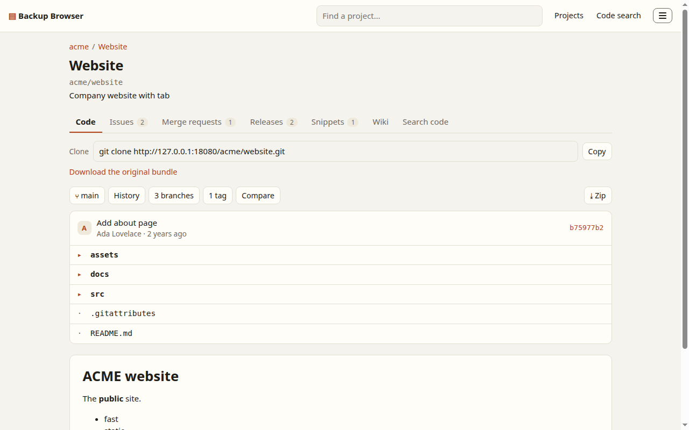

# gitlab-backup-browser (`gbb`)

Browse and clone the repositories inside a **GitLab backup** without restoring
it. Point a single executable at a `*_gitlab_backup.tar` and get a read-only,
GitLab-like web UI plus `git clone` URLs, on a laptop, a NAS, a Raspberry Pi or
an old Android phone. The same binary checks your nightly backups.

- No GitLab, no PostgreSQL, no Redis, no Docker: one static ~11 MB binary.
- Reads the backup **in place**: an uncompressed `.tar` is never extracted.
- Up in seconds; repositories are unbundled on first visit and cached.
- Small and steady memory footprint, suitable for a phone.
- `gbb verify` tells you whether last night's backup is complete, and what
  changed since the previous one.

> Status: early. Tested end to end on generated backups and on a real GitLab
> 19.5.3 backup (28.8 GB, 657 projects). Reports from other GitLab versions are
> very welcome.



More: [projects page](screenshots/projects.png),
[issue](screenshots/issue.png), [merge request](screenshots/merge-request.png).

## Why

Restoring a GitLab backup normally means standing up a GitLab of the *exact
same version*, then restoring everything. That is heavy when all you need is
the code: during an outage, after decommissioning an instance, or to check that
last night's backup really contains your repositories.

## Install

Download the binary for your system from the
[latest release](https://github.com/movenial/gitlab-backup-browser/releases/latest) and check it against `SHA256SUMS`:

```sh
curl -fLO https://github.com/movenial/gitlab-backup-browser/releases/latest/download/gbb-linux-amd64
curl -fLO https://github.com/movenial/gitlab-backup-browser/releases/latest/download/SHA256SUMS
sha256sum -c --ignore-missing SHA256SUMS
sudo install -m 755 gbb-linux-amd64 /usr/local/bin/gbb
```

There are binaries for Linux (amd64, arm64, armv7), Android (arm64, for
[Termux](docs/android.md)), macOS (arm64, amd64) and Windows (amd64). Or build
it with Go 1.27 or newer:

```sh
go install github.com/movenial/gitlab-backup-browser/cmd/gbb@latest
```

Each release also has an image holding only the linux-amd64 binary, for hosts
that run gbb from cron with Docker:

```sh
docker run --rm -v /var/opt/gitlab/backups:/backups:ro -v gbb-data:/data \
  ghcr.io/movenial/gitlab-backup-browser:<tag> verify --data /data /backups/<backup>.tar
```

## Quick start

```sh
gbb serve /var/opt/gitlab/backups/1762135230_2026_11_03_19.5.3_gitlab_backup.tar
# → open http://localhost:8080

gbb serve          # no argument: pick a backup in the browser
                   # (looks in /var/opt/gitlab/backups, ~/Downloads, …; or --backups DIR)

git clone http://localhost:8080/group/project.git

gbb verify --deep --previous yesterday.tar today.tar   # exit 0 ok, 1 warnings, 2 errors

gbb demo /tmp/sample   # no backup at hand? two small sample backups (needs git)
```

## What you get

- Groups, subgroups and users with their real names, descriptions,
  visibility and archived state; a Projects page to filter (groups, personal
  projects, bots and service accounts, archived, visibility, empty, topic,
  group) and sort (activity, name, size, newest, open issues or MRs).
- Links to a line or a range of lines (click, shift-click) and a "Copy
  link" button that pins the commit; light, dark or automatic theme.
- File tree, file view with syntax highlighting (built in, about 25
  languages and config formats), rendered Markdown, images, raw and `.zip`
  downloads of any branch, tag or commit.
- Branches, tags, history (per file too), commits with diffs, and a compare
  view between any two branches, tags or commits.
- Wikis, browsable and clonable.
- Code search across the default branch of every project (text or regular
  expression, path filter), streamed as results come in.
- Issues and merge requests, read-only, with comments, attachments, labels
  (scoped labels too) and milestones, filterable by label and milestone, and
  each merge request's changes; Labels and Milestones pages per project.
  Confidential issues and internal comments are readable only behind a
  login (`--auth`); without one they show as placeholders.
- Releases with their notes and asset links (attachments served from the
  backup, source code as `.zip` of the tag).
- Diffs of commits and merge requests with syntax highlighting.
- Snippets, project and personal: files with highlighting, raw, and
  `git clone` of their repositories.
- Git LFS files, shown in the browser and fetched by `git clone` with git-lfs
  (`--lfs`, or `--lfs=head` for default branches only).
- `git clone` / `fetch` of every repository and wiki, with any git client
  (git, libgit2, JGit); a first clone shows the unbundling progress.
- Projects without a repository and bundles no project points to are shown,
  so nothing in the backup is hidden.
- A Backups page to switch between the archives in a directory, and buttons
  to extract LFS or uploads, unbundle the busiest repositories or delete old
  caches (same login as the site; disabled on the network without `--auth`).
- Backup checks with JSON output and Prometheus metrics.

## Documentation

- [Commands and flags](docs/configuration.md)
- [Monitoring nightly backups](docs/monitoring.md): `verify`, comparison with
  the previous backup, Prometheus metrics and alerts
- [Running permanently](docs/running.md): systemd service and nightly check,
  start on boot with Termux:Boot
- [Running on an Android phone](docs/android.md): Termux, battery, memory
- [Exporting all repositories](docs/export.md): to a folder, Forgejo or Gitea
- [GitLab versions](docs/compatibility.md): what is tested, differences
  handled, how schema changes are detected
- [How it works](docs/how-it-works.md): backup formats, import, git
  implementation, security

## Not yet supported

- Group wikis (`@groups/` in the backup: skipped, so not checked by
  `verify` either), design management files (checked by `verify`, not
  browsable), epics.
- CI/CD data (pipelines, job logs, artifacts), packages and container
  images: out of scope for a lightweight browser.
- Snippets from before GitLab 13 (their content was in the database): they
  are listed without their files.
- Search across all issues and merge requests (search is per project).
- Reading backups directly from S3 / MinIO; pushing a backup to Forgejo /
  Gitea ([docs/export.md](docs/export.md) has a script meanwhile).
- Shallow and partial clones (`--depth` is refused, `--filter` gives a full
  clone); fetches always download the whole repository.
- SHA-256 repositories; several users or per-project permissions (one
  login sees everything).

## Development

```sh
go test ./...        # needs git on PATH for the end-to-end tests
go run ./cmd/gbb demo /tmp/sample
go run ./cmd/gbb serve /tmp/sample/day1/*_gitlab_backup.tar
```

The parsers that read backups have fuzz targets (`go test -run XXX -fuzz
FuzzReadPack ./internal/gitstore`); a weekly workflow runs all of them for
ten minutes (`fuzz`), and another checks the database schema against recent
GitLab versions (`gitlab-schema`). See `.github/workflows/`.

Cross-compile, e.g. for Termux:

```sh
CGO_ENABLED=0 GOOS=android GOARCH=arm64 go build -trimpath -tags nethttpomithttp2 -ldflags="-s -w" -o gbb ./cmd/gbb
```

`-tags nethttpomithttp2` leaves out Go's HTTP/2 code, which gbb never uses
(it serves plain HTTP/1.1); with `-s -w` the binary is about 11 MB.

Tagging `v*` builds release binaries for Linux, Android, macOS and Windows,
with a `SHA256SUMS`, and publishes them as a GitHub Release, plus a
FROM-scratch image `ghcr.io/movenial/gitlab-backup-browser:<tag>` holding
the linux-amd64 binary.

## Contributing

Bug reports and pull requests are welcome. In a bug report, give the output
of `gbb version`, the GitLab version of the backup and the flags gbb was
started with. A change must pass `go vet`, `gofmt`, `staticcheck` and
`go test -race ./...`, which CI runs on every pull request. For a security
problem, see [SECURITY.md](SECURITY.md). Changes are listed in
[CHANGELOG.md](CHANGELOG.md).

## Support

gbb is free and MIT-licensed. If it saved your backups, donations are welcome:

| Coin | Address |
|---|---|
| Bitcoin (BTC) | `bc1qlhdxwtf8u64alj6pz35yzr5yjga436rhhk4l4x` |
| Ethereum (ETH, USDC, USDT) | `0xA013BE82986A20B11FA0735DFF99f25f13Fab39f` |
| Monero (XMR) | `45dWX9Sspz8VSHTm1hKomWDxgKCkHiVPAbK8hdGYaf8MKvXR8ue263nVKU9ayj9ruR5VNxLbkLLvj7hjZuZXhpKJQBeTKsa` |
| Litecoin (LTC) | `ltc1qywhzshxsn8ccpurse44e37vtavrm4lx53xrx7h` |
| Dogecoin (DOGE) | `DFx6nz5tT9xG3vN4q466FBTPLcDYBguofH` |

## License

[MIT](LICENSE). The only dependency, [goldmark](https://github.com/yuin/goldmark),
is MIT-licensed too; its notice is in
[THIRD_PARTY_NOTICES.md](THIRD_PARTY_NOTICES.md).
